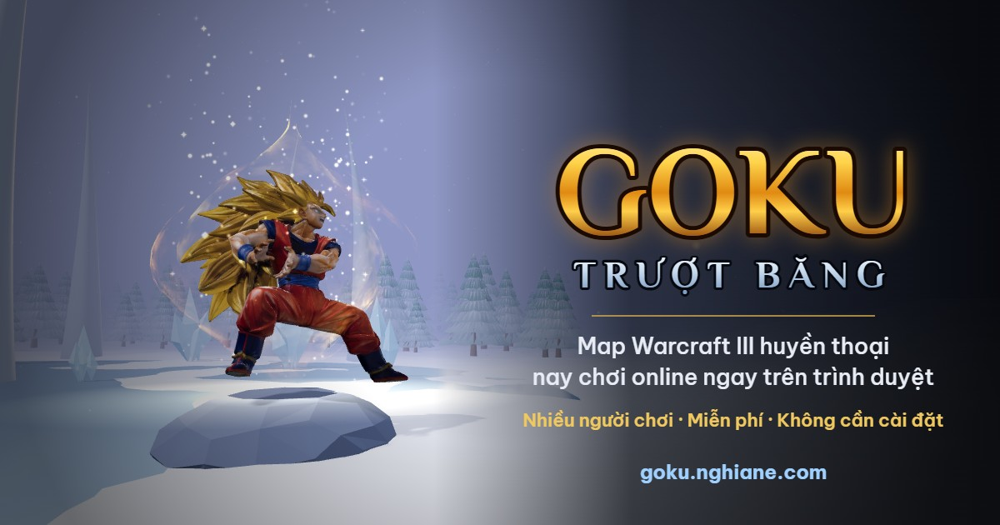

# Goku Trượt Băng

Bản web nhiều người chơi của map Warcraft III **Goku truot bang** (tác giả gốc: vietnghiavnn). Người chơi điều khiển Goku trượt trên mặt băng, né đàn rồng, cứu đồng đội và về đích qua 4 vòng, ngay trên trình duyệt, không cần cài đặt.

**Chơi thử:** https://goku.nghiane.com



## Tính năng

- **Luật chơi bám sát map gốc:** trượt băng theo hướng nhìn, đi bộ trên đá hoa, rồng tuần tra theo vùng, chết thì để lại vòng cứu cho đồng đội, mốc kinh nghiệm ở các góc rẽ, thêm rồng sau mỗi vòng. Toàn bộ trigger được đối chiếu trong [docs/phan-tich-map.md](docs/phan-tich-map.md).
- **5 kỹ năng của Goku:** Nhảy, Phong hành, Bầy dơi, Tăng tốc, Làm tan băng, học dần đến cấp 14.
- **Cửa hàng Krusty Krab:** 3 quán ở đúng vị trí trong map gốc, 12 vật phẩm (Bùa Hồi Sinh, Khiên Băng, giày, thuốc, sách…), ghép đồ, hộp quà xuất hiện ngẫu nhiên trên băng.
- **7 viên Ngọc Rồng:** rơi hiếm từ hộp quà hoặc khi hạ rồng; gom đủ để gọi Rồng Thần và chọn một điều ước.
- **Đồ hoạ 3D:**
  - Model Goku và rồng là model gốc của map, có đủ animation.
  - Địa hình dựng lại từ dữ liệu map, phủ texture tuyết, đá, băng.
  - Ngày đêm luân phiên, bão tuyết ngẫu nhiên.
  - Ba mức đồ hoạ, tự giảm khi máy yếu.
- **Chơi online:**
  - Phòng công khai, phòng có mật khẩu hoặc phòng riêng (vào bằng mã), tối đa 11 người.
  - Tài khoản tên + mật khẩu, bảng xếp hạng, vào lại trận khi rớt mạng.
- **Điện thoại:** điều khiển cảm ứng (cần gạt, kỹ năng kéo để ngắm), giao diện riêng cho màn ngang và màn dọc.

## Kiến trúc

```
Trình duyệt (Vue 3 + three.js)                 Máy chủ (Go)
┌─────────────────────────────┐   WebSocket   ┌──────────────────────────────┐
│ dự đoán vị trí Goku của mình│ ◄───────────► │ mô phỏng trận 50 tick/giây   │
│ nội suy người chơi khác/rồng│   lệnh  ►     │ snapshot 25 lần/giây,        │
│ vẽ 3D, HUD, nhạc nền        │   ◄ snapshot  │ riêng cho từng người chơi    │
└─────────────────────────────┘               │ phòng, tài khoản, chống spam │
                                              └──────┬──────────────┬────────┘
                                                     │              │
                                                PostgreSQL        Redis
                                         (tài khoản, kết quả)  (phiên, vào lại trận)
```

- **Máy chủ quyết định mọi thứ.**
  - Trình duyệt chỉ gửi lệnh (click, tung chiêu, mua đồ…). Server kiểm tra hợp lệ, giới hạn tần suất và ghi lại toàn bộ lệnh của trận.
  - Vị trí Goku của chính mình được dự đoán ngay tại trình duyệt rồi đối chiếu với server, nên click là thấy phản hồi tức thì.
- **Tiết kiệm băng thông.**
  - Mỗi người chơi chỉ nhận rồng trong vùng camera, dạng nhị phân 8 byte/con. Bản đồ nhỏ nhận vị trí thô của mọi con rồng 2 lần/giây.
  - Chi tiết kỹ năng và túi đồ chỉ gửi cho chính chủ.
  - Kết nối bật nén permessage-deflate.
  - Một phòng 11 người dùng khoảng 15 KB/s cho mỗi người chơi.

## Cấu trúc thư mục

```
server/                      Go module "gokutruotbang"
  cmd/server/                HTTP + WebSocket server
  cmd/mapconv/               đọc file .w3x -> internal/mapdata/map.json (+ trích model/texture)
  cmd/loadtest/              giả lập nhiều người chơi để đo hiệu năng
  internal/w3x/              đọc MPQ, w3e (địa hình), wpm (pathing), wts, doodad, script JASS
  internal/mapdata/          map.json (nhúng vào binary) + tra cứu địa hình
  internal/game/             luật chơi: trượt, rồng, kỹ năng, vật phẩm, vòng chơi, snapshot
  internal/netserver/        phòng chơi, đăng nhập, vòng lặp tick, gửi snapshot, /metrics
  internal/store/            tài khoản (bcrypt), phiên, kết quả trận: bộ nhớ hoặc Postgres + Redis
web/                         Vue 3 + Vite + TypeScript
  src/components/            trang chủ, sảnh, phòng chờ, màn chơi, HUD, cửa hàng, điều khiển cảm ứng
  src/game/                  dự đoán chuyển động, địa hình, vật phẩm, icon
  src/game3d/                renderer three.js, thế giới 3D, model MDX, thời tiết, chất lượng đồ hoạ
  public/assets/             model/texture trích từ map, texture Poly Haven, icon
deploy/                      script triển khai + cấu hình nginx
docs/                        phân tích map gốc, script JASS đã giải nén
```

## Chạy trên máy

Yêu cầu: Go 1.26+, Node.js 20+.

```bash
cd web && npm install && npm run build
cd ../server && go run ./cmd/server -addr :8080 -static ../web/dist
```

Mở http://localhost:8080, tạo tài khoản, tạo phòng rồi bấm **Bắt đầu trò chơi**. Không đặt `DATABASE_URL` thì server lưu dữ liệu trong bộ nhớ, đủ để phát triển.

Khi sửa giao diện, chạy thêm Vite (tự chuyển `/ws` và `/api` sang cổng 8080):

```bash
cd web && npm run dev
```

### Biến môi trường

| Biến | Mặc định | Ý nghĩa |
|---|---|---|
| `ADDR` | `:8080` | địa chỉ lắng nghe |
| `STATIC_DIR` | `../web/dist` | thư mục client đã build |
| `DATABASE_URL` | (trống) | PostgreSQL; trống thì dùng bộ nhớ |
| `REDIS_URL` | (trống) | Redis cho phiên và vào lại trận |
| `ALLOWED_ORIGINS` | (trống) | các domain được phép mở WebSocket, cách nhau dấu phẩy; trống = cho phép mọi nơi |
| `SIM_LATENCY_MS` | `0` | giả lập độ trễ mạng (chỉ dùng khi thử nghiệm) |

## Kiểm thử và đo hiệu năng

```bash
cd server && go test ./...          # luật chơi, vật phẩm, tài khoản, kích thước snapshot
cd web && npx vue-tsc --noEmit      # kiểm tra kiểu TypeScript
```

Giả lập người chơi thật (đăng ký tài khoản bot, vào phòng, di chuyển, tung chiêu) rồi đo lưu lượng, độ đều của snapshot và ping:

```bash
cd server && go run ./cmd/loadtest -url ws://localhost:8080/ws -bots 11 -rooms 1 -dur 60s
cd server && go run ./cmd/loadtest -url wss://your-domain/ws -origin https://your-domain -ping 50   # chỉ đo ping
```

Server cung cấp số liệu vận hành tại `/metrics`: số phòng, số người, thời gian xử lý tick, lưu lượng gửi đi. Kết quả tham khảo:

| | 1 phòng, 11 người | 10 phòng, 110 người |
|---|---|---|
| Thời gian xử lý mỗi tick (ngân sách 20 ms) | trung bình 0,05 ms | trung bình 0,02 ms |
| Khoảng cách giữa các snapshot (chuẩn 40 ms) | p99 41 ms | p99 42 ms |
| RAM server | 22 MB | 64 MB |

## Triển khai

Docker Compose gồm app Go, PostgreSQL và Redis. App chỉ mở cổng ở `127.0.0.1`; nginx trên máy chủ làm reverse proxy và SSL (mẫu cấu hình ở [deploy/nginx](deploy/nginx)).

```bash
cp .env.example .env              # đổi POSTGRES_PASSWORD, ALLOWED_ORIGINS
docker compose up -d --build
```

Cập nhật từ máy phát triển lên máy chủ (đóng gói mã nguồn, build lại image, khởi động lại):

```bash
HOST=root@your-server bash deploy/deploy.sh
```

Nếu đặt domain sau CDN/proxy, cần kiểm tra độ trễ WebSocket: proxy có thể định tuyến người chơi qua nước khác và làm ping tăng nhiều lần. Game cần ping thấp, nên trỏ DNS thẳng về máy chủ.

## Điều khiển

| Máy tính | Tác dụng |
|---|---|
| Chuột phải / trái | Trên băng: đổi hướng trượt · Trên đá: đi tới điểm đó |
| Q W E R A | Dùng kỹ năng (E, A cần chọn điểm) |
| Nút `+` hoặc Shift + phím | Học / nâng cấp kỹ năng |
| B | Mở cửa hàng (đứng gần quán Krusty Krab) |
| 1 – 6 | Dùng vật phẩm trong túi |
| S | Dừng đi bộ |
| Space / mũi tên / lăn chuột | Camera theo Goku / di chuyển camera / phóng to, thu nhỏ |
| Enter | Chat (chủ phòng gõ `-kick p2` để mời Goku 2 ra) |
| F1 / F10 | Hướng dẫn / Menu (âm lượng nhạc, chất lượng đồ hoạ) |

Trên điện thoại: cần gạt bên trái để đi hoặc đổi hướng trượt; kỹ năng xếp vòng cung bên phải, kéo E/A để ngắm, kéo vào ô **Hủy** để huỷ; ô đồ và nút cửa hàng ở giữa phía dưới.

## Dữ liệu map

Dữ liệu chơi (địa hình, pathing, vùng, unit, doodad, chuỗi) được trích sẵn vào `server/internal/mapdata/map.json`. File `.w3x` gốc không nằm trong repository; khi có file map, tạo lại dữ liệu bằng:

```bash
cd server && go run ./cmd/mapconv -in "../Goku truot bang v2.2.w3x" -out internal/mapdata/map.json -assets ../web/public/assets -dump ../docs/original
```

## Tài nguyên và ghi công

- **Map gốc, model Goku và rồng:** từ map *Goku truot bang* của **vietnghiavnn**.
- **Texture và HDRI:** [Poly Haven](https://polyhaven.com) (CC0).
- **Nhạc nền:** [Wintery Loop](https://opengameart.org/content/wintery-loop) (trang chủ) và [Determined Pursuit](https://opengameart.org/content/determined-pursuit-epic-orchestra-loop) (trong trận) của Emma_MA trên OpenGameArt (CC0).
- **Icon:** [game-icons.net](https://game-icons.net) (CC BY 3.0), tác giả Lorc và Delapouite.
- **Phông chữ:** Philosopher và Be Vietnam Pro (Google Fonts, SIL Open Font License).
- **Model Goku ở trang chủ:** [Goku Ultra Instinct](https://sketchfab.com/3d-models/goku-ultra-instinct-cf9e76bde83e4d398154acb3abc7961f) của AKIN trên Sketchfab. Tác giả chưa công bố giấy phép cho phép tải về và phân phối lại, nên file model (`web/public/assets/menu/goku_ui.glb`) không nằm trong repository. Khi thiếu file này, trang chủ tự dùng model Goku gốc của map.

Warcraft III là thương hiệu của Blizzard Entertainment. Dragon Ball là tác phẩm của Akira Toriyama / Shueisha / Toei Animation. Đây là dự án phi thương mại do người hâm mộ thực hiện.

---

© VigStudio
